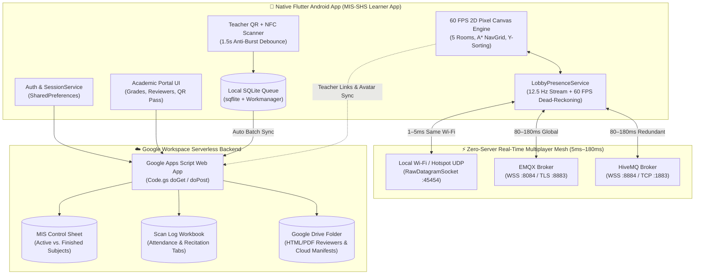

# 🏫 MIS-SHS Learner App — Academic Portal, Offline QR/NFC Scanner & 2D Live Multiplayer School Campus

**Version:** `1.2.4+7`  
**Platform:** Native Flutter Android (`SDK >=3.4.0 <4.0.0`)  
**Backend Architecture:** Serverless Google Workspace Stack (`Google Apps Script` + `Google Sheets` + `Google Drive`) + Multi-Transport Real-Time Mesh (`Binary MQTT v3.1.1 over WSS/TCP/TLS` + `LAN UDP Broadcast`)

---

## 📖 Table of Contents

1. [Project Overview & Core Vision](#1-project-overview--core-vision)
2. [High-Level System Architecture](#2-high-level-system-architecture)
3. [In-Depth Feature Breakdown](#3-in-depth-feature-breakdown)
   - [3.1 Academic Records & Gradebook Portal](#31-academic-records--gradebook-portal)
   - [3.2 Google Drive Reviewer Streamer & Offline `.txt` Outline Extractor](#32-google-drive-reviewer-streamer--offline-txt-outline-extractor)
   - [3.3 Offline-First Teacher QR & NFC Classroom Scanner](#33-offline-first-teacher-qr--nfc-classroom-scanner)
   - [3.4 2D Pixel-Art Virtual School Campus (5 Explorable Rooms)](#34-2d-pixel-art-virtual-school-campus-5-explorable-rooms)
   - [3.5 Ultra-Low-Latency Real-Time Multiplayer Engine](#35-ultra-low-latency-real-time-multiplayer-engine)
   - [3.6 Curriculum Gamification, Teacher Link Manager & Enrollment Filtering](#36-curriculum-gamification-teacher-link-manager--enrollment-filtering)
4. [Candid Engineering Critique: Current Flaws & Trade-Offs](#4-candid-engineering-critique-current-flaws--trade-offs)
   - [4.1 Networking & Multiplayer Security Limitations](#41-networking--multiplayer-security-limitations)
   - [4.2 Backend Concurrency & Data Persistence Flaws](#42-backend-concurrency--data-persistence-flaws)
   - [4.3 Game Engine, UX & Classroom Moderation Gaps](#43-game-engine-ux--classroom-moderation-gaps)
   - [4.4 Codebase Maintainability & Platform Constraints](#44-codebase-maintainability--platform-constraints)
5. [Future Roadmap & High-Impact Improvements](#5-future-roadmap--high-impact-improvements)
6. [Repository Structure](#6-repository-structure)
7. [Setup, Deployment & CI/CD Build Guide](#7-setup-deployment--cicd-build-guide)

---

## 1. Project Overview & Core Vision

The **MIS-SHS Learner App** is an all-in-one mobile platform engineered for **Senior High School learners and faculty**. Originally conceived as a native Android port of a web-based Google Apps Script Student Records Portal (`index.html` + `Code.gs`), the project evolved into a three-pillar educational ecosystem:

1. **Academic Transparency**: Instant mobile access to official subject enrollments, quarterly grade breakdowns, attendance logs, and teacher-curated Google Drive reviewers.
2. **Zero-Friction Classroom Operations**: An **offline-first QR Code and NFC Tag Scanner** for teachers to log daily classroom **Attendance** and **Recitation points** even inside classrooms with dead Wi-Fi or mobile data spots, automatically batch-syncing to Google Sheets once connectivity returns.
3. **Intrinsic Student Engagement (2D Virtual Campus)**: A custom-built **60 FPS 2D Pixel-Art School Campus** where students and teachers create custom layered pixel avatars, walk across 5 interconnected school rooms, see each other **live in real time**, chat via overhead **Cloud Thought Bubbles (`💭`)**, sit/nap/sleep on campus furniture, and level up their character by completing real **Reviewer Links** and **Activity Quests** posted by their teacher.

### Why a "Zero-Server" Architecture?
Public and private high schools rarely have dedicated DevOps budgets for cloud VMs, managed PostgreSQL instances, or paid WebSocket servers. Every feature in the **MIS-SHS Learner App** is designed to run at **\$0.00/month** using:
- **Google Sheets** as the relational database for grades, enrollment control, attendance, and recitation logs.
- **Google Drive** as the content delivery and cloud manifest store for HTML/PDF reviewers and custom avatar/quest payloads.
- **Google Apps Script (`Code.gs`)** as the serverless REST API gateway.
- **Direct Binary MQTT v3.1.1 + Local Wi-Fi UDP Broadcast** for sub-200ms real-time multiplayer presence without touching Google Apps Script quotas.

---

## 2. High-Level System Architecture



---

## 3. In-Depth Feature Breakdown

### 3.1 Academic Records & Gradebook Portal
- **Role-Aware Sign-In ([`AuthScreen`](lib/screens/auth_screen.dart) & [`SessionService`](lib/services/session_service.dart))**:
  - Students authenticate with their official `Student ID`; Faculty authenticate with their `Faculty ID` and receive an HMAC-verified `scannerAuthToken`.
  - Includes a **"Stay signed in on this device"** toggle backed by `SharedPreferences` so students and teachers do not need to re-authenticate on cold starts, plus quick-remembered Student ID pre-filling.
- **Interactive Gradebook & Subject Cards ([`StudentHomeScreen`](lib/screens/student_home_screen.dart))**:
  - Displays per-subject academic standing, Written Works (WW), Performance Tasks (PT), Quarterly Assessment (QA), and transmuted final grades.
  - Faculty accounts gain access to the **Teacher Masterlist & Gradebook Inspector**, allowing lookup of any student's live academic record.
- **Offline Student ID QR Pass ([`StudentQrGenerator`](lib/widgets/student_qr_generator.dart))**:
  - Generates a crisp, high-contrast QR code pass directly on-device from the normalized Student ID (`MIS_SHS_QR_<ID>.png`) that can be presented to the teacher's scanner or exported/shared without internet access.

### 3.2 Google Drive Reviewer Streamer & Offline `.txt` Outline Extractor
- **Live Google Drive Folder Integration (`1EFX9aylAeSRmDWU7OeFIPa0llAMD8wC5`)**:
  - Automatically crawls the class Google Drive Reviewer repository, matching files to subjects (`PGP`, `UCSP`, `PPG`, `PKLP TERM 2`, `PHILO`, etc.) and week numbers (`Week 1`–`Week 20`).
  - Streams interactive HTML slide decks inside an embedded `WebView` and opens PDF/PPTX documents directly.
- **Smart HTML-to-Outline Extractor ([`ReviewerOutlineExtractor`](lib/utils/reviewer_outline_extractor.dart))**:
  - Many interactive HTML slide decks are heavy or require JavaScript navigation chrome. The built-in parser strips all `<script>`, `<style>`, navigation buttons (`Prev`/`Next`), and CSS rules, converting multi-slide HTML presentations into a clean, hierarchical `.txt` study outline (`[PART X OF Y]`, headings, bullet points, and HTML entity decoding) that students can save and read offline on any phone.

### 3.3 Offline-First Teacher QR & NFC Classroom Scanner
- **Dual-Hardware Scanning ([`TeacherScannerScreen`](lib/screens/teacher_scanner_screen.dart))**:
  - Supports continuous high-speed camera QR scanning (`mobile_scanner`) and contactless NFC student ID tap scanning (`nfc_manager` + `ndef_record`).
- **Attendance vs. Recitation Modes ([`ScanLogEntry`](lib/models/portal_models.dart))**:
  - **Attendance Mode (`ATT-...`)**: Logs `[Log_ID, Timestamp, Student_ID, Subject]` to the `"Attendance Log"` sheet tab.
  - **Recitation Mode (`REC-...`)**: Automatically attaches `Points_Awarded = 1` and logs `[Log_ID, Timestamp, Student_ID, Subject, 1]` to the `"Recitation_Log"` sheet tab.
- **Anti-Burst Debounce (`1500ms`) & Offline Queue ([`LocalDatabaseService`](lib/services/local_db_service.dart) & [`SyncService`](lib/services/sync_service.dart))**:
  - Enforces a `1.5-second` cooldown window so holding a QR code in front of the lens never double-counts a recitation point.
  - Every scan is written immediately to a local SQLite table (`scan_logs`) and synced in batches via `Workmanager` background tasks and `ConnectivityPlus` network listeners.

### 3.4 2D Pixel-Art Virtual School Campus (5 Explorable Rooms)
Located in [`lib/school_lobby/`](lib/school_lobby/), the Virtual School Campus is a custom-rendered 2D tile & sprite engine ([`SchoolLobbyCanvasPainter`](lib/school_lobby/school_lobby_engine.dart)) running at **60 FPS**:
- **5 Distinct Campus Rooms (`48×34` grid, `1536×1088` world pixels each)**:
  1. **🏫 Main School Lobby (`LobbyRoomId.mainLobby`)**: Features **Aiko (Receptionist / Quest Counter NPC)**, the **School Bulletin Board**, **Teacher's Advisory Corner**, the **Student Study Lounge**, **Enrolled Subject Treasure Chests**, **8 Small Mystery Quiz Chests**, and 4 architectural doors leading to the other campus rooms.
  2. **🌳 Campus Park (`LobbyRoomId.park`)**: Outdoor green courtyard populated with lush pixel trees, garden shrubs, picnic tables, wooden park benches, and grassy study lawns.
  3. **🎓 SHS Class Room (`LobbyRoomId.classroom`)**: Academic lecture hall featuring a front chalkboard wall, an interactive **Teacher's Lecture Podium** (where the teacher can manage Reviewer/Activity links directly), and neat rows of student armchairs.
  4. **🍱 School Canteen (`LobbyRoomId.canteen`)**: Dining hall equipped with interactive **Snack & Drink Vending Machines** (`🧋 Iced Wintermelon Milktea`, `🥟 Steamed Siomai Cup`, `🥪 Clubhouse Sandwich`, etc.), service counter, and cafeteria tables.
  5. **💼 Faculty Room (`LobbyRoomId.facultyRoom`)**: Quiet consultation and advising lounge with bookshelves, conference tables, and faculty desks.
- **Guided Walk-Paths, Floor Signposts & A\* Wayfinder**:
  - Paved stone and royal-gold carpet walkways with directional arrows clearly connect the spawn plaza to every door and station.
  - Tapping anywhere on the floor (or on the top-right **Mini-Map Radar**, or selecting a station from the **`🧭 Guide` Wayfinder Menu**) computes an obstacle-avoiding **8-directional A\* path** ([`LobbyNavGrid`](lib/school_lobby/school_lobby_engine.dart)) and renders a glowing **Golden Guide Trail** directly to the destination.
- **Custom Layered Pixel Avatar Studio ([`AvatarSpriteCache`](lib/school_lobby/school_lobby_avatar.dart))**:
  - Players choose between **16 preset characters** or build a custom layered avatar across **9 pixel-art part categories** (`Skin/Body`, `Eyes`, `Uniform/Outfit`, `Hair`, `Face`, `Glasses`, `Hat`, `Gloves`, `Backpack`), composited on the fly into a 56-frame `ui.Image` sprite sheet (`32×64` per frame) and backed up to Google Drive.
- **Student Rest States (`🪑 Sit`, `😪 Nap`, `🛌 Sleep`)**:
  - Approaching any chair, classroom desk, park bench, lounge sofa, or park lawn lets the student sit down, take a power nap, or sleep flat with animated floating `💤` particles.

### 3.5 Ultra-Low-Latency Real-Time Multiplayer Engine
Implemented in [`LobbyPresenceService`](lib/school_lobby/lobby_presence_service.dart), the multiplayer system allows all online students and teachers to see each other live across all 5 rooms without any custom server setup:
- **Multi-Transport Real-Time Streaming (`5ms–180ms` Latency)**:
  - **Channel 1 — Local Wi-Fi / Mobile Hotspot UDP Broadcast (`RawDatagramSocket` port `45454`)**: Delivers movement and Thought Bubble packets in **1–5 milliseconds** when devices share a school Wi-Fi router or phone hotspot.
  - **Channels 2–5 — Redundant Persistent Binary MQTT v3.1.1 Connections**: Simultaneously maintains open binary MQTT streams to `broker.emqx.io` (`WSS :8084` + `TLS :8883`) and `broker.hivemq.com` (`WSS :8884` + `TCP :1883`) using a custom zero-dependency Dart MQTT v3.1.1 wire encoder/decoder (`_RealtimeMqttChannel`).
- **12.5 Hz Movement Streaming + `0ms` Instant State Transitions**:
  - Streams `(x, y)` coordinates and velocity vectors `(vx, vy)` every **80ms (`12.5 Hz`)** while walking.
  - Immediately broadcasts (`0ms` delay + `95ms` burst duplicate for lossy mobile networks) whenever a player starts/stops walking, changes facing direction, switches rooms, sits/naps/sleeps, waves (`👋`), or posts a **Cloud Thought Bubble (`💭`)**.
- **60 FPS Velocity Dead-Reckoning & Monotonic Sequence Guard (`seq`)**:
  - Every packet carries `sessionMs` and a strictly increasing sequence counter `seq`. Out-of-order or duplicate packets from redundant brokers (`seq <= existing.lastSeq`) are discarded in `O(1)` time, eliminating rubber-banding.
  - Between 80ms network ticks, [`tickInterpolation`](lib/school_lobby/lobby_presence_service.dart) projects remote walking avatars along their velocity vector and glides them smoothly at 60 FPS.
- **Live `"🟢 X Online"` HUD Directory ([`showOnlinePlayersModal`](lib/school_lobby/school_lobby_modals.dart))**:
  - Shows every real student and teacher currently online across all 5 rooms, their live activity status (`🚶 Walking`, `🪑 Sitting`, `😪 Napping`, `🛌 Sleeping`), and their active Thought Bubble, with a 1-tap **`Join Room 🚪 / Walk To ➔`** button that switches rooms and guides you right to them.
  - By default, simulated offline practice bots are hidden (`showOfflineClassmates = false`) so only **100% real online users + Aiko (Lobbyist)** appear on the map.

### 3.6 Curriculum Gamification, Teacher Link Manager & Enrollment Filtering
- **Strict MIS Control Sheet & Student Enrollment Filtering ([`LobbyDataService`](lib/school_lobby/lobby_data_service.dart))**:
  - Enforces the `MIS Control Sheet` (`Subject Enrollment` tab) rules: subjects marked **Finished** (such as Term 1 `PKLP`) are automatically hidden, while **Active** subjects (`PGP`, `UCSP`, `PPG`, `PKLP TERM 2`, `PHILO`) are filtered strictly against the logged-in student's enrolled subjects. A student only sees Treasure Chests, Quests, and Pop-Quizzes for subjects they actually take.
- **Teacher Link Manager (`🔗 Manage Links` / Classroom Podium / Quest Counter)**:
  - All Reviewer Chests and Activity Quests start clean and empty by default.
  - When logged in as a **Teacher (`isFaculty: true`)**, the teacher can add **Reviewer URLs / Google Drive Links** to any Subject Chest and post **Activity Quests** (with custom XP rewards and achievement badges) at the Quest Counter or Classroom Podium.
  - Published links sync across all student phones via cloud manifest `999999001`.
- **Anti-Cheat "Launch ➔ Mark as Done" Character Progression**:
  - To earn XP (`+50` to `+200 XP`) and unlock overhead Badges (`👑 Quiz Conqueror`, `🏆 Treasure Hunter`, `🌟 Early Bird`, etc.), a student must first tap **`1. Open Link`** (which launches the teacher's Reviewer or Activity URL) before the **`2. Mark Done (+XP)`** button unlocks.

---

## 4. Candid Engineering Critique: Current Flaws & Trade-Offs

To evaluate this project honestly as both a **production mobile application** and a **multiplayer 2D game**, below is a transparent audit of its current architectural flaws, bottlenecks, and technical debt.

### 4.1 Networking & Multiplayer Security Limitations
1. **Reliance on Public MQTT Brokers (`broker.emqx.io` & `broker.hivemq.com`)**:
   - **Flaw**: While connecting to public MQTT brokers over `WSS`/`TCP`/`TLS` solves the "zero-server, zero-cost" requirement and achieves `~80–180ms` latency, public brokers have no uptime SLA and are shared globally. If a public broker experiences maintenance or regional throttling, only the secondary broker or local Wi-Fi UDP broadcast (`:45454`) remains active.
2. **Unauthenticated Multiplayer Topic & Spoofing Vulnerability**:
   - **Flaw**: All clients publish JSON payloads to a shared MQTT topic (`mis_shs/campus_lobby/live_v2/state`). Currently, packets do not carry a cryptographic signature tied to the user's Google Apps Script session. Anyone who decompiles the topic string could theoretically publish crafted JSON packets pretending to have `[TEACHER]` status (`"isFaculty": true`) or spoof another student's nickname.
3. **Full-Campus Broadcast Scaling Ceiling (~40–60 Concurrent Users)**:
   - **Flaw**: All 5 rooms currently share a single MQTT topic (`mis_shs/campus_lobby/live_v2/state`), meaning a student in the `Main Lobby` still receives and parses network packets from students walking in the `Canteen` or `Park`. While negligible for 10–35 concurrent students (`~3–5 KB/s`), scaling to 150+ simultaneous users walking at `12.5 Hz` would create unnecessary CPU/bandwidth overhead unless sharded into per-room topics (`.../room/mainLobby`, `.../room/park`, etc.).

### 4.2 Backend Concurrency & Data Persistence Flaws
1. **"Last-Write-Wins" Race Condition on Cloud Manifests (`999999001`)**:
   - **Flaw**: To avoid requiring teachers to redeploy `Code.gs` when adding the 2D Lobby, the app stores shared Teacher Reviewer/Activity links in a special Google Drive file (`id = '999999001'`) using the existing `uploadStudentAvatar` / `getStudentAvatar` endpoints. Because this performs a client-side *read ➔ modify JSON ➔ re-upload full file* cycle without server-side mutex locking (`LockService` in Apps Script), two teachers adding links at the exact same second could overwrite each other's changes.
2. **Local-Only RPG Character Progression (`SharedPreferences`)**:
   - **Flaw**: A student's `LobbyPlayerProgress` (XP, Level, completed Reviewer IDs, completed Activity IDs, and earned Badges) is stored locally in `SharedPreferences` (`lobby_progress_<studentId>`).
   - **Impact**: If a student uninstalls the app, clears storage, or logs in on a different phone, their avatar look and nickname restore from Google Drive, **but their Level, XP, and earned Badges reset to Level 1 (`0 XP`)**. Furthermore, teachers cannot yet view a centralized leaderboard of student RPG levels/XP in Google Sheets.
3. **Google Apps Script Cold-Start Latency (`2.5s–5.0s`)**:
   - **Flaw**: Google Apps Script web apps spin down after periods of inactivity. When a student signs in or when the app fetches the Google Drive Reviewer manifest for the first time in a session, Google's V8 runtime cold-start can take 3–5 seconds.
4. **Hardcoded Fallback Curriculum & Control Sheet Snapshot**:
   - **Flaw**: While [`LobbyDataService`](lib/school_lobby/lobby_data_service.dart) dynamically syncs with the live backend when online, its offline fallback map of Active vs. Finished subjects (`_kControlSheetSubjectStatus`) is hardcoded in Dart. When Term 2 ends and Term 3 begins, updating the offline fallback requires a code update unless cached dynamically from the sheet into `SharedPreferences`.

### 4.3 Game Engine, UX & Classroom Moderation Gaps
1. **No Chat Profanity Filter or Teacher Mute/Kick Switch**:
   - **Flaw**: Students can type any 56-character message into a **Cloud Thought Bubble (`💭`)**, which immediately broadcasts to every online phone in the room. In a real high school environment, students may test boundaries with inappropriate slang or spam unless a client/server profanity wordlist filter and a **Teacher "Mute Campus Chat / Freeze Lobby"** toggle are in place.
2. **Client-Side Collision Desynchronization on Diagonal Obstacles**:
   - **Flaw**: Remote players are interpolated between `(x, y)` coordinates using linear dead-reckoning (`p.targetPos + p.velocity * dt`). If a remote player walks rapidly around a tight L-shaped furniture corner during a brief 150ms network jitter spike, their avatar on another screen may briefly clip the corner of a table before snapping to the next authoritative coordinate.
3. **"Launch ➔ Mark as Done" Honor System**:
   - **Flaw**: While requiring students to tap **`1. Open Link`** before **`2. Mark Done (+XP)`** prevents blind 1-tap XP farming, the app cannot verify how long the student actually spent reading an external Google Form or Drive link in their browser before returning to tap `Mark Done`.
4. **Static Furniture & Lack of Room Capacity Indicators on Doors**:
   - **Flaw**: Before walking through a door (e.g., into the `Canteen` or `Park`), the door signpost on the canvas does not yet show a live badge like `🟢 4 Players Inside`, requiring the user to open the `🟢 X Online` HUD pill to see which room their friends are in.

### 4.4 Codebase Maintainability & Platform Constraints
1. **Large Monolithic UI Modal File ([`school_lobby_modals.dart`](lib/school_lobby/school_lobby_modals.dart) ~5,000 Lines)**:
   - **Flaw**: Almost all bottom sheets and dialogs for the 2D Lobby (Quest Counter, Subject Chests, Mystery Quiz, Teacher Link Manager, Thought Bubble Composer, Avatar Customizer, Online Directory, Badges Drawer, Canteen Vending) live inside a single ~5,000-line file (`lib/school_lobby/school_lobby_modals.dart`). While functional, splitting this into smaller per-feature files (`modals/quest_counter_modal.dart`, `modals/online_directory_modal.dart`, etc.) will significantly improve readability and IDE navigation.
2. **Hardcoded Tile & Furniture Coordinates ([`school_lobby_config.dart`](lib/school_lobby/school_lobby_config.dart))**:
   - **Flaw**: All 5 room layouts, wall boundaries, walk paths, and furniture placements are defined via Dart `const` lists rather than loaded from standard JSON/Tiled map files (`assets/maps/classroom.json`). Moving a chair or adding a tree currently requires editing X/Y pixel coordinates in Dart.
3. **Deprecated Flutter `Color.withOpacity()` Calls**:
   - **Flaw**: Newer Flutter SDKs (`3.27+`) flag `.withOpacity(...)` as a non-fatal deprecation info lint in favor of `.withValues(alpha: ...)`. Migrating these calls across `lib/school_lobby/` will keep `flutter analyze` 100% lint-free even with `--fatal-infos`.

---

## 5. Future Roadmap & High-Impact Improvements

Below is a prioritized engineering and product roadmap to elevate the **MIS-SHS Learner App** from a high-functioning school innovation into a commercial-grade educational platform:

### 🔒 Phase 5A: Security, Moderation & Dedicated Real-Time Infrastructure
1. **Room-Sharded Topics + Teacher Broadcast Channel**:
   - Shard MQTT traffic by room (`mis_shs/campus/v2/room/<roomId>`) for high-frequency `12.5 Hz` position updates while keeping a lightweight global presence topic (`mis_shs/campus/v2/directory`) updated every 3 seconds.
2. **HMAC Packet Signing & Teacher Role Verification**:
   - Sign outgoing multiplayer packets using a session key derived during `ApiService` login so `[TEACHER]` tags (`isFaculty: true`) and Student IDs cannot be spoofed.
3. **Built-In Classroom Moderation Suite (Teacher HUD Controls)**:
   - Add a **Profanity & Slang Filter** on Thought Bubbles (`💭`).
   - Give Faculty accounts a **`🔇 Mute Campus Chat`**, **`📢 Broadcast School Announcement Banner`**, and **`🧲 Summon All Online Students to Class Room`** button in the Teacher HUD!

### ☁️ Phase 5B: Cloud-Backed RPG Progression & QR/NFC Gamification Bridge
1. **Cross-Device Cloud Save for XP, Levels & Badges**:
   - Sync `LobbyPlayerProgress` (`XP`, `Level`, `EarnedBadges`, `CompletedReviewers`, `CompletedActivities`) to a dedicated `"Lobby_Progress"` tab in Google Sheets (or cloud manifest per student) so students keep their level across devices and teachers can view a **Live Class XP Leaderboard**.
2. **Real-World QR/NFC Scan ➔ In-Game Reward Bridge**:
   - Connect the **Teacher QR/NFC Scanner** directly to the 2D School Lobby! Every time a student's QR/NFC pass is scanned for **Attendance**, automatically award **`+25 XP`** to their 2D Lobby character; every **Recitation scan (`REC-...`)** automatically awards **`+50 XP`** and unlocks the **`🎤 Recitation Star`** overhead badge!
3. **In-App Timer / Embedded Quiz Verification for Reviewer Links**:
   - Require a minimum 45-second active study timer inside the in-app WebView or a 3-question comprehension check before unlocking the **`Mark as Done (+XP)`** button on Reviewer Links.

### 🎮 Phase 5C: Next-Gen Multiplayer Gameplay & Social Features
1. **Live Multiplayer "Quiz Showdown" in the `Class Room`**:
   - Allow the Teacher standing at the **Class Room Podium** to launch a live 60-second question on the chalkboard. All online students in the room physically run their pixel avatars onto **Floor Tile `A`, `B`, `C`, or `D`** before the timer hits zero—turning review sessions into an energetic live game show!
2. **Live Player Count Badges on Room Doors**:
   - Render a floating **`🟢 5 Inside`** pill directly above the `Park`, `Class Room`, `Canteen`, and `Faculty Room` doors in the `Main Lobby` so students can see where their classmates are gathering without opening a menu.
3. **Peer-to-Peer High-Five / Study Group Buffs**:
   - When 3 or more real online students sit together at the same `Canteen` table or `Park` lawn and study a Reviewer Chest, grant a **`1.25x Study Group XP Boost`**!
4. **Dynamic Philippine Standard Time (`UTC+8`) Day/Night Cycle**:
   - Optionally sync the campus lighting (`Day` vs. `Night` mode with glowing warm streetlamps in the Park) automatically with real local time in the Philippines (`6:00 PM – 6:00 AM`).

---

## 6. Repository Structure

```text
├── .github/workflows/
│   └── build-android-apk.yml          # Automated CI/CD: Flutter Analyze, Unit Tests, APK Build & GitHub Release
├── assets/
│   ├── images/mis_logo.png            # Official MIS-SHS Emblem
│   └── school_lobby/
│       ├── catalog/atlas.json         # Furniture, Trees, Vending Machines, Desks & Decor Sprite Atlas Metadata
│       ├── characters/
│       │   ├── presets/               # 16 Full 56-Frame Character Sprite Sheets
│       │   └── parts/                 # Custom Layered Avatar Parts (body, eyes, outfit, hair, glasses, hat, bag, etc.)
│       └── tilesets/textures/         # Floor & Wall Textures + Full Furniture Atlas PNG
├── lib/
│   ├── main.dart                      # App Entrypoint, Workmanager Init & Root Routing
│   ├── config/app_config.dart         # App Constants & Google Apps Script Endpoint Config
│   ├── models/portal_models.dart      # UserSession, SubjectItem, ScanLogEntry & Grade Models
│   ├── screens/
│   │   ├── auth_screen.dart           # Student & Faculty Login with "Stay Signed In"
│   │   ├── student_home_screen.dart   # Academic Dashboard, Grades, Reviewers & 2D Lobby Launcher
│   │   └── teacher_scanner_screen.dart# Offline-First QR & NFC Classroom Scanner (Attendance & Recitation)
│   ├── services/
│   │   ├── api_service.dart           # Google Apps Script REST Client
│   │   ├── local_db_service.dart      # SQLite Offline Queue for Classroom Scans
│   │   ├── session_service.dart       # Persistent Login Session Manager
│   │   └── sync_service.dart          # Background Batch Sync Engine
│   ├── utils/
│   │   └── reviewer_outline_extractor.dart # HTML Slide Deck -> Clean Offline .txt Study Outline Parser
│   ├── widgets/
│   │   └── student_qr_generator.dart  # Local Student ID QR Code Pass Generator & Exporter
│   └── school_lobby/
│       ├── school_lobby_screen.dart   # Main 60 FPS Game Loop, Top HUD, Mini-Map Radar & Room Transitions
│       ├── school_lobby_engine.dart   # CustomPainter 2D Tile/Furniture/Avatar Renderer & A* Pathfinding Grid
│       ├── school_lobby_config.dart   # 5-Room Layouts, Furniture Coordinates, Walk Paths & Rest Spots
│       ├── school_lobby_avatar.dart   # 9-Layer Custom Pixel Avatar Compositor & Onboarding Studio
│       ├── school_lobby_controls.dart # Virtual Touch Joystick & Action/Rest/Thought Cluster
│       ├── school_lobby_modals.dart   # Interactive Modals (Quests, Chests, Link Manager, Online Directory, Chat)
│       ├── lobby_data_service.dart    # Enrollment Filtering, Drive Reviewer Sync, Quests, XP & Badges Service
│       └── lobby_presence_service.dart# Real-Time Binary MQTT v3.1.1 (WSS/TCP/TLS) + LAN UDP Multiplayer Engine
├── test/
│   └── widget_test.dart               # Automated Unit & Widget Test Suite (Scanner, Session, Outline, 2D Lobby & Multiplayer)
├── code gs.txt                        # Google Apps Script Backend Source (Code.gs)
├── index.html                         # Original Web Portal Reference
└── pubspec.yaml                       # Flutter Dependencies & Asset Declarations
```

---

## 7. Setup, Deployment & CI/CD Build Guide

### 7.1 Google Apps Script Backend (`code gs.txt`)
> **Note:** Upgrading between `v1.2.x` releases of the Android APK (including the 5-Room Campus, Teacher Link Manager, and Real-Time Multiplayer) requires **zero changes** to your existing Google Apps Script deployment. Only follow the steps below if setting up the backend for the first time.

1. Open your Google Apps Script project and paste the contents of [`code gs.txt`](code%20gs.txt) into `Code.gs`.
2. Ensure the deploying Google account has edit permissions for your Google Sheets workbooks:
   - **Scan Log Workbook ID**: `12DvradQOqCeswwKMtdx7jaIKDRjMUuxWRRD_p1WBCQQ`
   - **Reference Tab**: `"Reference"` (Column C lists selectable subjects)
   - **Attendance Tab**: `"Attendance Log"` (`[Log_ID, Timestamp, Student_ID, Subject]`)
   - **Recitation Tab**: `"Recitation_Log"` (`[Log_ID, Timestamp, Student_ID, Subject, Points_Awarded=1]`)
3. Click **Deploy ➔ Manage deployments ➔ Edit (pencil icon) ➔ New version ➔ Deploy**:
   - **Execute as**: `Me`
   - **Who has access**: `Anyone`

### 7.2 Building the Android APK Locally
```powershell
# 1. Fetch Dart/Flutter dependencies
flutter pub get

# 2. Run static analysis & unit tests
flutter analyze --no-fatal-infos --no-fatal-warnings
flutter test

# 3. Compile release Android APK
flutter build apk --release
```

### 7.3 Automated GitHub Actions CI/CD Release Pipeline
Every push to the `main` branch automatically triggers [`.github/workflows/build-android-apk.yml`](.github/workflows/build-android-apk.yml), which:
1. Provisions Java 17 and Flutter Stable on Ubuntu.
2. Generates a version-matched Android Gradle wrapper and configures Android permissions (`CAMERA`, `NFC`, `INTERNET`) and app icons.
3. Executes `flutter analyze` and the full unit test suite in [`test/widget_test.dart`](test/widget_test.dart).
4. Compiles the signed release APK (`MIS-SHS-Learner-App-v<version>-release.apk`) and publishes it directly to **GitHub Releases** and **Actions Artifacts**.
